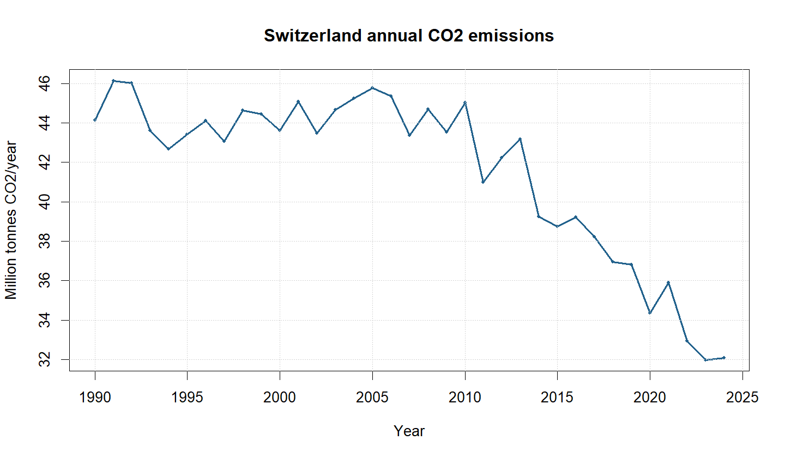
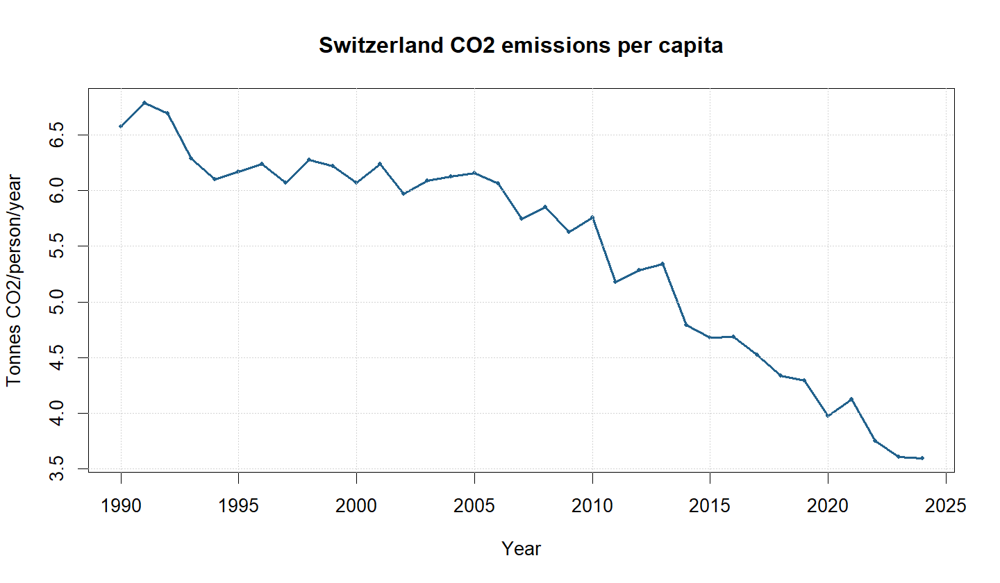
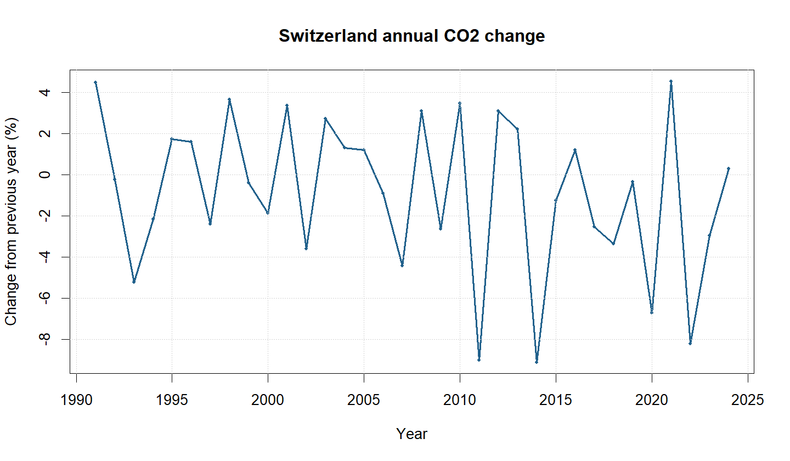

# co2-emissions-CHE
**Student:** Lumbab, Klent Jhon D.
**Country / ISO-3:** Switzerland / CHE
**Study period:** 1990 to 2024
**Declared to instructor on:** [November 9, 2026]

## Research question
How have annual CO2 emissions and per-capita emissions changed in Switzerland?

## Data source and definitions
Our World in Data (OWID) CO2 and Greenhouse Gas Emissions dataset.
Dataset: https://github.com/owid/co2-data
Downloaded on: [DATE]. Selected columns: year, co2, co2_per_capita.
co2 is million tonnes per year; co2_per_capita is tonnes/person/year.

## How to reproduce the analysis
1. Install R, RStudio, and Git. Open this repository as an RStudio Project.
2. Use an internet connection for the first full CSV download.
3. In the RStudio Console, run:
   source("scripts/analyze_co2.R")
4. Inspect data/, figures/, and results/.

## Results
- Earliest / latest valid years: 1990 to 2024.
- Annual emissions in those years: Check your `results/CHE_summary.csv` for the exact numbers (1990 emissions and 2024 emissions) and put them here with units (million tonnes).
- Endpoint percentage change: -27.35 %.
- Peak emissions year: 1991 at 45.48% million tonnes.
- Latest available per-capita value: 3.6 tonnes/person.

## Interpretation (200-300 words)
In Switzerland, valid annual CO2 emissions data cover the study period from 1990 (44.12 million tonnes) to 2024 (32.10 million tonnes), representing an overall endpoint percentage change of -27.24%. Absolute emissions reached their historical peak in 1991 at 46 million tonnes of carbon per year. While absolute emissions report total national carbon output in million tonnes, emissions per capita. This per-capita metric provides a more direct reflection of average domestic consumption intensity, ensuring that demographic shifts do not obscure broader structural decarbonization efforts across the nation.” Both indicators generally mirror each other in trend for Switzerland, declining over recent decades as population growth was outpaced by reductions in energy intensity.
A plausible driver for Switzerland's long-term emissions decline is its heavy reliance on zero-carbon electricity generation (hydroelectric and nuclear power) combined with aggressive national policies under the Swiss CO2 Act, such as the thermal building insulation program and carbon levying on heating fuels (Swiss Federal Office for the Environment, 2022). Also, the subsequent post-pandemic tracking demonstrates whether this rapid drop represented a brief operational interruption or accelerated Switzerland’s trajectory toward its long-term climate targets.”

National emissions patterns are ecologically vital because cumulative global CO2 directly drives climate change, ocean acidification, and habitat disruption[span_12](start_span)[span_12](end_span)[span_13](start_span)[span_13](end_span). However, a key limitation of country-level territorial data is that it only measures emissions produced physically *within* national borders, ignoring consumption-based emissions embodied in imported goods and services, an important factor for high-import nations like Switzerland[span_14](start_span)[span_14](end_span)[span_15](start_span)[span_15](end_span)[span_16](start_span)[span_16](end_span).

## Limitations
- **Territorial Accounting:** The dataset relies on territorial carbon accounting, which only tracks emissions produced *within* Switzerland's physical borders. It omits "embodied" emissions from imported goods and services consumed by the population[span_2](start_span)[span_2](end_span)[span_3](start_span)[span_3](end_span).
- **Exclusion of Land-Use Change:** The main `co2` indicator accounts strictly for fossil fuels and industrial processes, excluding emissions or carbon sequestration from land-use change, forestry, and agriculture[span_4](start_span)[span_4](end_span)[span_5](start_span)[span_5](end_span)[span_6](start_span)[span_6](end_span).
- **Data Gaps and Estimates:** These figures are emission estimates rather than direct atmospheric measurements or tracking of all greenhouse gases, and missing historical years must never be treated as zero[span_7](start_span)[span_7](end_span)[span_8](start_span)[span_8](end_span)[span_9](start_span)[span_9](end_span).
- **Cross-Country Comparability:** Raw national totals can be misleading when comparing countries of vastly different geographic sizes or populations without scaling per capita[span_10](start_span)[span_10](end_span)[span_11](start_span)[span_11](end_span)[span_12](start_span)[span_12](end_span).

## References
Our World in Data. CO2 and Greenhouse Gas Emissions data[span_6](start_span)[span_6](end_span).
[Add an independent academic or news reference supporting your policy/energy context explanation here[span_7](start_span)[span_7](end_span)[span_8](start_span)[span_8](end_span).]

